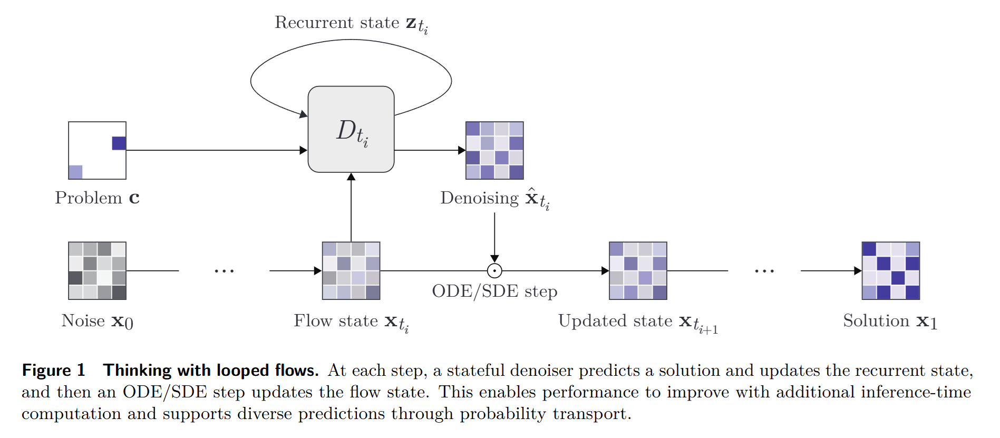

# Minimal implementation of Looped Flows

This repository contains a minimalistic and clean implementation of Looped Flows from [Thinking with Looped Flows](https://arxiv.org/pdf/2609.11801)




## Installation

```bash
micromamba create -n minLF python=3.12
pip install -r requirements.txt
```

## Usage

```bash
python nqueens.py \
    --bs 128 \
    --num_epochs 400 \
    --eval_interval 100 \
    --infer_reps 20 \
    --infer_steps 128 \
    --gamma 5.0 \
    --hidden_size 512
```

## TODO

- [ ] Ablate `AdamAtan2` optimizer
- [ ] Ablate `EMA`
- [ ] Ablate `stablemax_cross_entropy`
- [ ] Ablate `trunc_normal_init_`