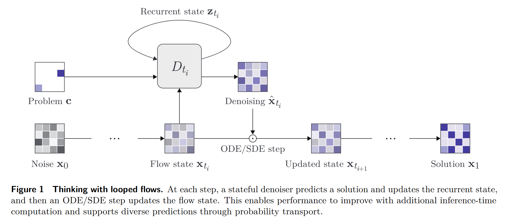

# Minimal implementation of Looped Flows

This repository contains a minimalistic and clean implementation of Looped Flows from [Thinking with Looped Flows](https://arxiv.org/pdf/2609.11801)




## Installation

```bash
micromamba create -n minLF python=3.12
pip install -r requirements.txt
```

## Usage

```bash
python nqueens.py \
    --bs 128 \
    --num_epochs 200 \
    --eval_interval 100 \
    --infer_reps 20 \
    --infer_steps 128 \
    --gamma 5.0 \
    --hidden_size 512
```

## Results

8-Queens test set (773 puzzles, 1277 solutions), 20 samples per puzzle,
128 steps, γ=5. Trained with the command above plus `--no_scheduler`.
Each ablation changes one thing w.r.t. the baseline (single run each).

Each cell is accuracy / coverage.

| Epoch | Baseline        | w/o AdamAtan2   | w/o EMA         | w/o StableMax   | w/o StableMax, w/o trunc_normal_init_ | w/o StableMax, w/o trunc_normal_init_, w/o EMA |
|------:|:---------------:|:---------------:|:---------------:|:---------------:|:-------------------------------------:|:----------------------------------------------:|
| 50    | 0.5912 / 0.7283 | 0.3131 / 0.3117 | 0.1953 / 0.4002 | 0.9741 / 0.9616 | 0.9909 / 0.9514                       | 0.8745 / 0.8865                                |
| 100   | 0.4567 / 0.8716 | 0.2484 / 0.3868 | 0.0893 / 0.2717 | 0.9845 / 0.9561 | 0.9392 / 0.9186                       | 0.4321 / 0.6813                                |
| 150   | 0.7296 / 0.8966 | 0.7361 / 0.7619 | 0.0737 / 0.2036 | 0.9819 / 0.9381 | 0.9948 / 0.9608                       | 0.5123 / 0.7087                                |
| 200   | 0.0776 / 0.2083 | 0.9366 / 0.9186 | 0.0375 / 0.1292 | 0.9897 / 0.9632 | 0.9922 / 0.9538                       | 0.6417 / 0.8121                                |

**TLDR:** if you want you can throw out all the code for `stablemax_cross_entropy` and `trunc_normal_init_`.

### 10-Queens

10-Queens test set (6513 puzzles, 18414 solutions), 5 samples per puzzle,
32 steps, γ=5. Trained w/o StableMax, w/o trunc_normal_init_ for 25 epochs with `--nqueens 10 --no_scheduler`.
With 5 samples the max achievable coverage is 0.8218.

| Epoch | Accuracy | Coverage |
|------:|:--------:|:--------:|
| 5     | 0.6498   | 0.5531   |
| 10    | 0.4869   | 0.4713   |
| 15    | 0.5523   | 0.4936   |
| 20    | 0.6748   | 0.5635   |
| 25    | 0.4230   | 0.4320   |

## TODO:

- [x] Ablate `AdamAtan2` optimizer
- [x] Ablate `EMA`
- [x] Ablate `stablemax_cross_entropy`
- [x] Ablate `trunc_normal_init_`

